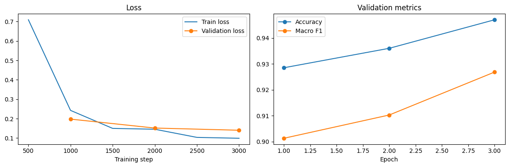
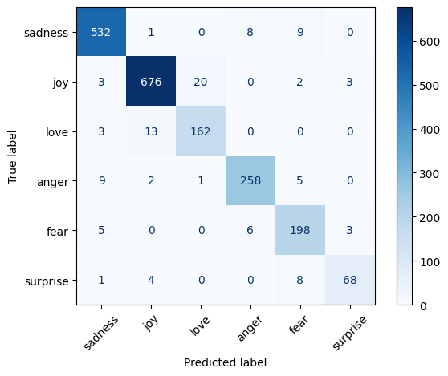
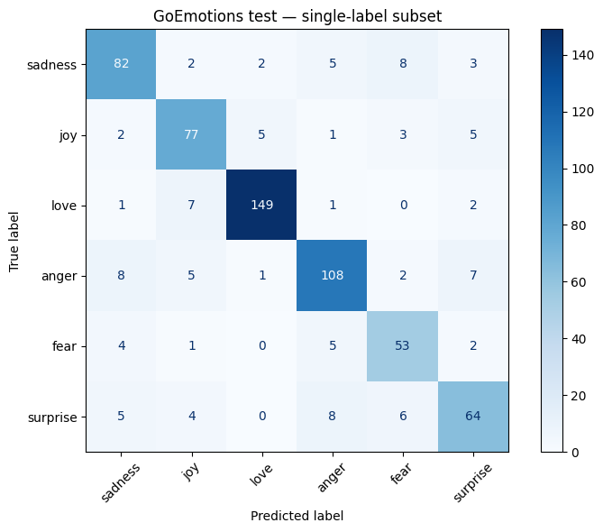

# Báo cáo fine-tuning DistilBERT — Phân loại cảm xúc tiếng Anh

**Cập nhật:** 08/10/2026  
**Nguồn số liệu:** output lưu trong notebooks/emotion.ipynb  
**Model:** distilbert/distilbert-base-uncased  
**Nhãn:** sadness, joy, love, anger, fear, surprise

## Tóm tắt

Notebook ghi nhận hai lần fine-tune:

1. **Baseline DAIR.AI:** 16.000 câu train, 3 epoch. Kết quả tốt nhất ở epoch 3: **94,70% accuracy** và **0,9268 Macro F1** trên DAIR.AI validation.
2. **Fine-tune kết hợp:** tiếp tục từ checkpoint baseline, dùng 21.272 câu train: 16.000 DAIR.AI và 5.272 GoEmotions đã lọc. Epoch 2 đạt **92,99% accuracy / 0,9146 Macro F1** trên validation gộp.
3. **Đánh giá riêng sau fine-tune kết hợp:** DAIR.AI validation đạt **94,55% / 0,9216**; GoEmotions validation đạt **88,00% / 0,8688**; GoEmotions test subset đạt **83,54% / 0,8199**.

Trên cùng GoEmotions test subset 638 câu, điểm tăng từ **50,00% / 0,4737** trước fine-tune kết hợp lên **83,54% / 0,8199** sau fine-tune. Đây là cải thiện lớn trên tập con này, đồng thời DAIR.AI validation giảm nhẹ so với baseline.

> Số liệu được lấy từ output Colab lưu trong notebook, chưa được chạy lại độc lập tại local. GoEmotions test baseline đã được xem trước khi chọn GoEmotions làm nguồn fine-tune; vì vậy phép so sánh trước/sau có giá trị chẩn đoán, không phải đánh giá cuối hoàn toàn độc lập.

## Dataset và cách lọc

### DAIR.AI Emotion

Notebook dùng config split: **16.000 train, 2.000 validation, 2.000 test**. Bộ dữ liệu gồm câu tiếng Anh từ Twitter với sáu nhãn cảm xúc. [Dataset card DAIR.AI Emotion](https://huggingface.co/datasets/dair-ai/emotion)

### GoEmotions

GoEmotions gồm bình luận Reddit và cho phép một câu có một hoặc nhiều nhãn. Bản simplified có **43.410 train, 5.426 validation, 5.427 test**. Để phù hợp với classifier sáu lớp đơn nhãn, notebook chỉ giữ mẫu có đúng một nhãn thuộc sáu lớp.

| Split | Số câu sau lọc |
|---|---:|
| Train | 5.272 |
| Validation | 625 |
| Test | 638 |

Đây là đánh giá trên một tập con đã lọc, không phải bài toán đa nhãn GoEmotions đầy đủ. [Dataset card GoEmotions](https://huggingface.co/datasets/google-research-datasets/go_emotions)

## Giai đoạn 1 — Baseline DAIR.AI

### Cấu hình

| Tham số | Giá trị |
|---|---:|
| Model nền | distilbert/distilbert-base-uncased |
| Dataset | DAIR.AI Emotion, config split |
| Số câu train | 16.000 |
| Seed | 42 |
| Max sequence length | 128 |
| Learning rate | 2e-5 |
| Batch size train/eval | 16 / 16 |
| Epoch | 3 |
| Weight decay | 0,01 |
| Chọn checkpoint | Validation Macro F1 cao nhất |
| Tổng bước train | 3.000 |
| Thời gian train | 178,0 giây |

### Metrics theo epoch

| Epoch | Training loss | Validation loss | Accuracy | Macro F1 |
|---:|---:|---:|---:|---:|
| 1 | 0,242443 | 0,197536 | 0,928500 | 0,901309 |
| 2 | 0,145299 | 0,151433 | 0,936000 | 0,910285 |
| 3 | 0,098820 | 0,140157 | 0,947000 | 0,926842 |

Validation loss giảm, Accuracy và Macro F1 tăng qua cả ba epoch. Run ngắn này chưa cho thấy dấu hiệu overfit rõ.

### Confusion matrix DAIR.AI validation

Ma trận có 2.000 câu; 1.894 câu được phân loại đúng.

| Nhãn | Số câu | F1 |
|---|---:|---:|
| sadness | 550 | 0,965 |
| joy | 704 | 0,966 |
| love | 178 | 0,898 |
| anger | 275 | 0,943 |
| fear | 212 | 0,912 |
| surprise | 81 | 0,877 |

Nhầm lẫn nổi bật: joy → love (20 câu), love → joy (13 câu), surprise → fear (8 câu). Surprise có recall thấp nhất: 68/81, khoảng 83,95%.

## Giai đoạn 2 — Fine-tune kết hợp DAIR.AI và GoEmotions

Model khởi tạo từ checkpoint baseline. Training set gồm DAIR.AI train và GoEmotions train đã lọc. Validation gộp gồm validation của cả hai bộ đã lọc.

### Cấu hình và quy mô

| Tham số | Giá trị |
|---|---:|
| Checkpoint khởi đầu | Baseline DAIR.AI |
| DAIR.AI train | 16.000 câu |
| GoEmotions train sau lọc | 5.272 câu |
| Tổng training rows | **21.272** |
| Validation gộp | 2.625 câu |
| Learning rate | 1e-5 |
| Batch size train/eval | 16 / 16 |
| Epoch | 2 |
| Max sequence length | 128 |
| Weight decay | 0,01 |
| Tổng bước train | 2.660 |
| Thời gian train | 176,7 giây |

### Metrics theo epoch trên validation gộp

| Epoch | Training loss | Validation loss | Accuracy | Macro F1 |
|---:|---:|---:|---:|---:|
| 1 | 0,222839 | 0,219158 | 0,926857 | 0,909002 |
| 2 | 0,145487 | 0,212673 | 0,929905 | 0,914566 |

Epoch 2 được chọn theo Macro F1 validation gộp.

### Metrics riêng sau fine-tune

| Tập đánh giá | Số câu | Loss | Accuracy | Macro F1 |
|---|---:|---:|---:|---:|
| DAIR.AI validation | 2.000 | 0,1443 | 0,9455 | 0,9216 |
| GoEmotions validation đã lọc | 625 | 0,4314 | 0,8800 | 0,8688 |
| GoEmotions test đã lọc | 638 | 0,6288 | 0,8354 | 0,8199 |

Trên cùng DAIR.AI validation, model kết hợp giảm **0,15 điểm phần trăm accuracy** và **0,52 điểm phần trăm Macro F1** so với baseline. Đây là mức giảm nhỏ. GoEmotions validation và test thấp hơn DAIR.AI, nhưng cao hơn rõ rệt so với baseline GoEmotions.

## GoEmotions test — so sánh trước và sau

Cả hai lần đánh giá dùng cùng 638 câu single-label đã lọc.

| Model | Accuracy | Macro F1 |
|---|---:|---:|
| Baseline DAIR.AI | 0,5000 | 0,4737 |
| Fine-tune kết hợp | **0,8354** | **0,8199** |
| Chênh lệch | **+33,54 điểm %** | **+34,62 điểm %** |

### Kết quả theo lớp sau fine-tune

| Nhãn | Precision | Recall | F1 | Support |
|---|---:|---:|---:|---:|
| sadness | 0,8039 | 0,8039 | 0,8039 | 102 |
| joy | 0,8021 | 0,8280 | 0,8148 | 93 |
| love | 0,9490 | 0,9313 | 0,9401 | 160 |
| anger | 0,8438 | 0,8244 | 0,8340 | 131 |
| fear | 0,7361 | 0,8154 | 0,7737 | 65 |
| surprise | 0,7711 | 0,7356 | 0,7529 | 87 |

Love là lớp tốt nhất với F1 0,9401. Surprise có F1 thấp nhất ở 0,7529; fear có precision thấp nhất ở 0,7361. Tất cả sáu lớp đều có F1 trên 0,75.

| Nhãn | F1 baseline | F1 sau fine-tune |
|---|---:|---:|
| sadness | 0,6176 | 0,8039 |
| joy | 0,4933 | 0,8148 |
| love | 0,2737 | 0,9401 |
| anger | 0,6018 | 0,8340 |
| fear | 0,5778 | 0,7737 |
| surprise | 0,2778 | 0,7529 |

## Checkpoint và khả năng tái lập

Notebook xác nhận đã lưu cả hai checkpoint lên Google Drive:

- Baseline: /content/drive/MyDrive/emo/distilbert-emotion
- Fine-tune kết hợp: /content/drive/MyDrive/emo/distilbert-emotion-mixed-v1

Run kết hợp dùng seed 42, learning rate 1e-5, batch size 16, hai epoch và max length 128. Output ghi nhận 21.272 câu train, 2.660 bước và 176,7 giây.

## Giới hạn và kết luận

- GoEmotions test subset có 638 câu sau khi loại mẫu đa nhãn và các nhãn ngoài sáu lớp.
- GoEmotions test baseline đã được xem trước khi chọn GoEmotions để fine-tune. Test không được dùng cập nhật trọng số, nhưng việc chọn nguồn dữ liệu có tham khảo kết quả test làm phép so sánh trước/sau kém độc lập hơn một đánh giá trên test mới.
- DAIR.AI test split chưa có metric trong notebook.
- Model giữ gần như toàn bộ chất lượng trên DAIR.AI validation và cải thiện rõ trên GoEmotions single-label subset. Chưa nên suy rộng kết quả này cho mọi văn bản tiếng Anh; nên đánh giá tiếp trên dữ liệu gần với nơi triển khai.

Điểm tham khảo trong trao đổi: khoảng **9/10 trên DAIR.AI** và **8/10 trên GoEmotions single-label subset**. Đây là nhận định định tính, không thay cho metrics và không phải điểm tổng hợp giữa hai miền.
